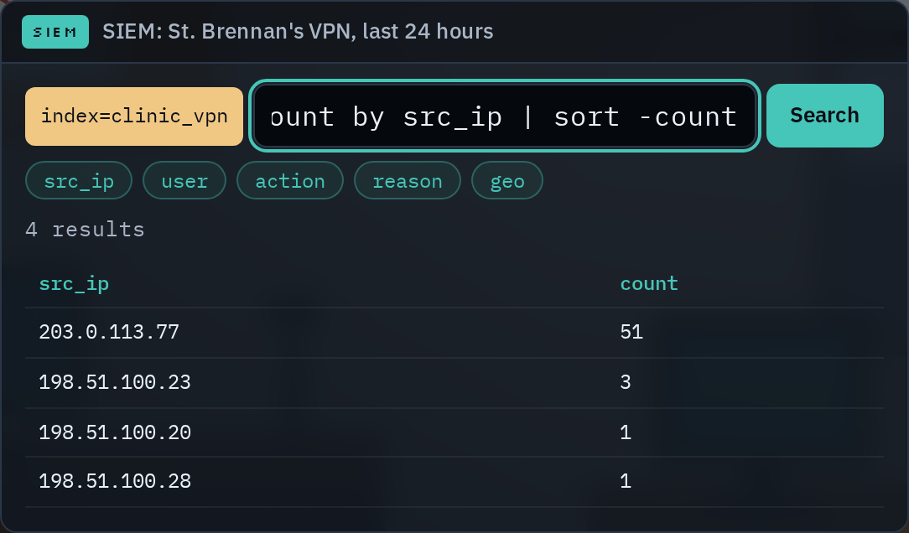
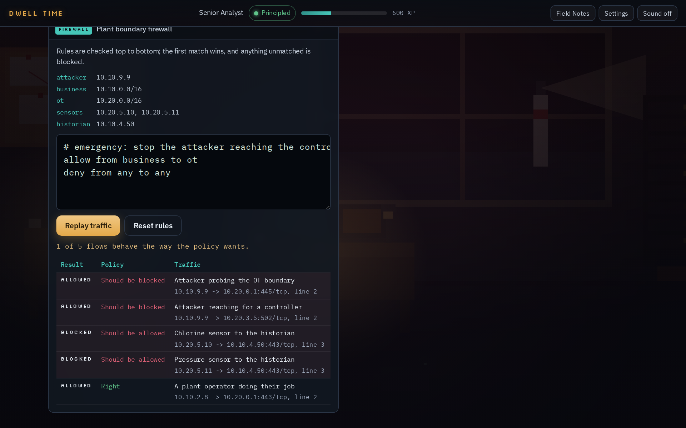

<h1 align="center">Dwell Time</h1>

<p align="center">A cozy-to-dark cybersecurity career simulation. Interview, investigate, and learn the trade one real case at a time.</p>

<p align="center">
  <a href="https://cyberahmedx.github.io/dwell-time/"><b>Play in your browser</b></a>
  &nbsp;·&nbsp;
  <a href="#screenshots">Screenshots</a>
  &nbsp;·&nbsp;
  <a href="#what-makes-it-tick">Features</a>
  &nbsp;·&nbsp;
  <a href="#run-it-locally">Run it</a>
</p>

<p align="center">
  
</p>

<p align="center"><i>Dwell time (noun): how long an intruder stays inside a network before anyone notices. It is also the whole plot.</i></p>

---

You are the newest hire at Lanternhouse Security, a small firm keeping a rainy harbor town safe. You interview for a team, close tickets, climb from Probationary Analyst to Lead, and slowly uncover what has been hiding in the quiet. Your choices lead to one of five endings.

It is built for students and people getting ready for a first SOC or help desk job: the cases are real scenarios, explained as you meet them. If you already do this for a living, Hard mode turns off the hints, gives you one attempt per case, and tightens the clock in the live finale.

## Screenshots

| Apply and interview for real | Learn the trade on real cases |
| :---: | :---: |
|  |  |
| **Six teams, each with a real interview** | **Evidence viewers for email, logs, flows and more** |

| It starts cozy and sunlit | It does not stay that way |
| :---: | :---: |
|  |  |
| **Chapter One: Fair Weather** | **Chapter Five: Storm Surge** |

| Do the job, not a quiz about it | Then do it against the clock |
| :---: | :---: |
|  |  |
| **Real tools: a SIEM, a terminal, a firewall, a request editor and more** | **A live incident where every wrong move costs time** |

The office darkens with the story: cozy and sunlit at first, then rain, then a storm blackout lit by emergency red. Lighting, weather, and the soundtrack all shift per chapter.

## What makes it tick

- **Six job interviews**, one per team: SOC, Network, Help Desk, Forensics, Pentest, Threat Intel. Each draws five questions from a larger pool, so a retry is a fresh interview. Pass one to get hired, and your team shapes the whole run: its own cases through the story, its own hard choice, its own part in the live finale, and a secret only your team can find.
- **A five-chapter main investigation** built from accurate scenarios: phishing, business email compromise, DNS tunneling, forensic timelines, scoped pentests, threat correlation, and a live incident at the water plant.
- **A side case in every chapter**, from a cat on the keyboard to a backup audit, a cast of coworkers, and **Field Notes** that unlock plain explanations of each concept as you meet it.
- **A real terminal**: dig through case files with `grep`, `cut`, `sort | uniq -c`, `sha256sum` and pipes, then type what you found. Any command that finds it counts.
- **Cases that change between runs**: some cases are built fresh each run, so the addresses, account names and the machine at fault are not the same twice. Replaying means reading the evidence again, not recalling an answer.
- **A SIEM to search**: Splunk-style queries like `action=failure | stats count by src_ip | sort -count`, over hundreds of events.
- **A firewall to fix**: write ufw-style rules, replay real traffic, and watch each flow get allowed or blocked. The first matching rule wins, just like the real thing.
- **An admin console**: lock down a hijacked account yourself. Reset the password, sign out every session, remove the attacker's mail rule, fix MFA, in the right order.
- **A timeline builder**: merge logs stamped by different clocks onto UTC. Get a time zone wrong and the malware calls home before the USB stick was plugged in. Plus `xxd` in the terminal, to read a file's magic bytes.
- **A request editor**: edit a request to a fictional booking site, send it, and read the reply. Change the booking id to prove a broken-access-control bug yourself, the way a pentester would.
- **A pivot board**: follow a domain to its address and on to the rest of an actor's infrastructure through passive DNS, so a block list covers all of it, not just the one name you were handed.
- **Raw email headers**: read a message's full source, work down the Received chain to where it really came from, and see why an SPF pass on the wrong domain means nothing.
- **A scope checker**: before you touch an address, check it against the engagement letter, with the subnet maths done for you. Exclusions win, and anything not listed is out.
- **A CVSS calculator**: rate a finding across the eight v3.1 metrics and get the same score the official calculator gives.
- **Indicators and defanging**: pull the indicators out of a report, defang them so nobody clicks one, and hand over a block list that covers the actor without catching the innocent bystander on the same host.
- **ATT&CK mapping**: look techniques up in an offline matrix, then map what the attacker did to the real technique IDs yourself.
- **Write a detection rule**: build a SIEM rule and test it against a replay of real attacks and false alarms. Catch the attack, stay quiet on everything else.
- **Write the incident report**: put it in your own words, checked for the root cause, what acted and from where, honest attribution, and a concrete fix.
- **A live finale**: chapter five runs against a clock. Relaxed timers doubles it, and the choices you made earlier can shorten it.
- **Take-home files**: download the block list and detection rule from a solved case, to keep or to adapt.
- **Click the evidence**: some questions ask you to point at the exact log row, email header, timeline event or process that proves it, the way an analyst would.
- **Hints that cost XP** when you are stuck, so guessing is never cheaper than reading.
- **MITRE ATT&CK tags** on each solved case, naming the real technique it covered (for example T1566 Phishing).
- **XP and ranks**: climb from Probationary Analyst to Lead Analyst as you close cases.
- **Original procedural music and sound**, synthesized live in the browser. Nothing is sampled or copied.
- **Five endings** driven by your choices about integrity, trust, and the truth. An endings gallery tracks the ones you have found, and after your first ending you can replay any chapter from where your last run stood. Download a share card of how your run ended.
- **Hard mode and practice mode**: Hard mode is no hints, one attempt per case, and a tighter finale clock, for players who already know the trade. Practice mode replays any case you have closed without touching your run.
- **Case Files**: every team has its own secret to uncover. Find all six across your runs for the Six Sides of the Story achievement.
- **Achievements** for how you played, like keeping the evidence chain intact, finishing on hard mode, or closing every case right on the first try.
- **Settings** for music and effects volume, text size, reduced motion, relaxed timers, and fast dialogue (show each conversation at once).
- **Export and import saves** as a file or a short code, to back up a run or carry it to another browser or device.

## Everything here is fictional and safe

Every company, person, address, and domain is invented. All IP addresses come from documentation ranges (192.0.2.0/24, 198.51.100.0/24, 203.0.113.0/24) or private ranges, all domains use the reserved `.example` and `.test` TLDs, and no link points at a real system. The test suite checks all of this.

## Run it locally

```bash
npm install
npm run dev      # local dev server
npm run build    # single self-contained HTML file in dist/
npm run check    # lint + typecheck + tests
npm run e2e      # plays the built game in Chromium: every ending, every track
```

The production build is one self-contained `dist/index.html` of about 500 KB, fonts included. It makes no network requests, so it works offline and can be hosted anywhere.

## Project layout

```
src/
  engine/    state, saves, ranks, flags, ending logic (pure, unit tested)
  scene/     the pixel office, chapter moods, character portraits
  audio/     the generative soundtrack and sound effects
  ui/        the app controller, evidence viewers, dialogue, interview
  content/   all writing: interviews, tickets, scenes, codex, endings
tests/       content house-rules and engine logic
e2e/         a bot that plays the real game in a browser
media/       screenshots and the demo clip
```

## Tech

TypeScript, Vite, Vitest, Playwright, ESLint. No game engine and no runtime framework. CI runs lint, typecheck and tests on every push, then plays the built game in a real browser to every ending; a successful build auto-deploys to GitHub Pages.

See `CREDITS.md` for asset provenance and `PRIVACY.md` for the privacy note.

## License

All rights reserved. See `LICENSE`.
