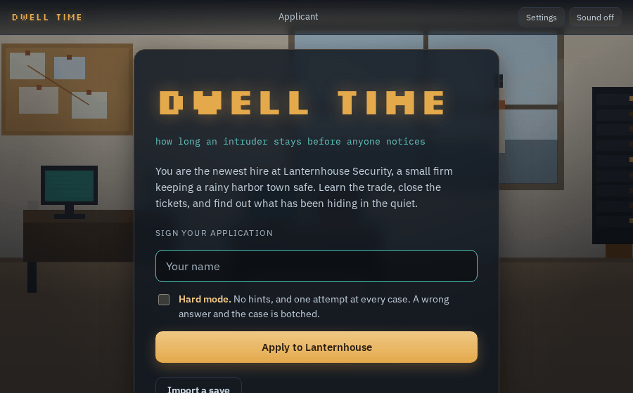
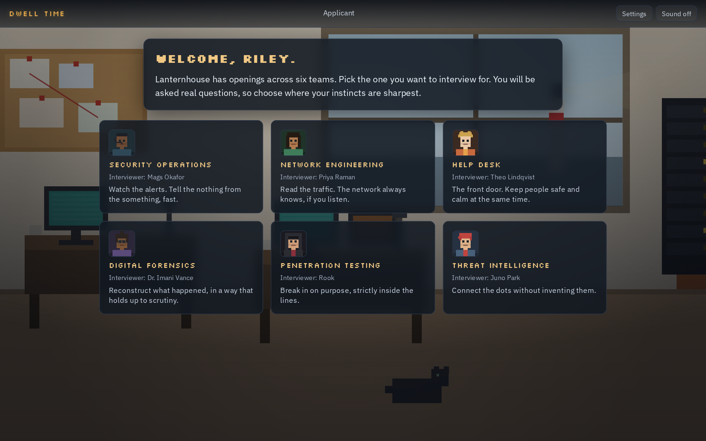
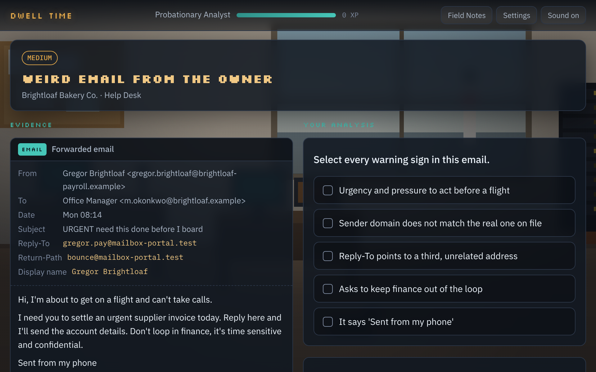
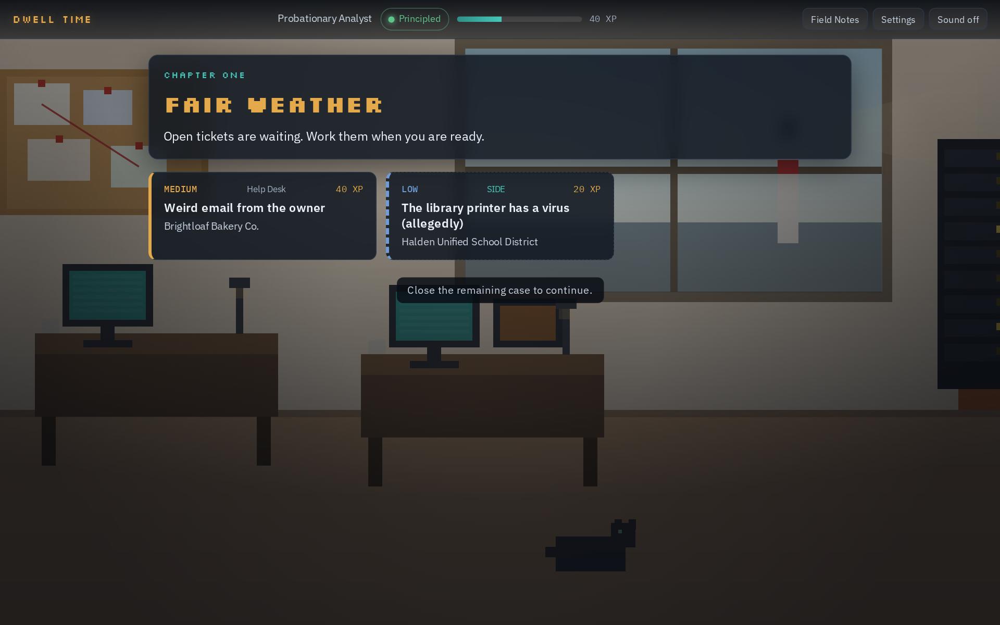
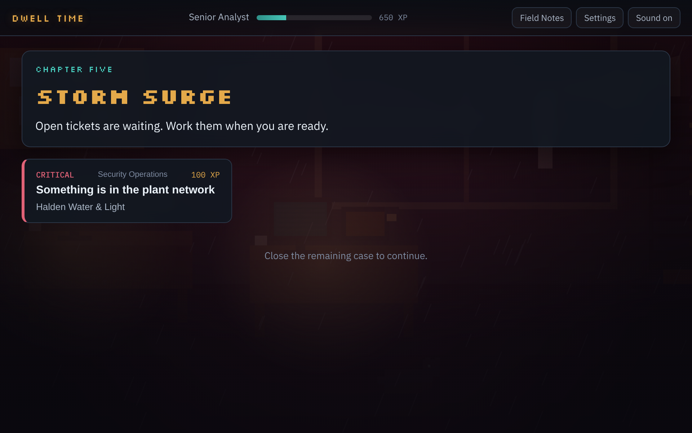

<h1 align="center">Dwell Time</h1>

<p align="center">A cozy-to-dark cybersecurity career simulation. Interview, investigate, and learn the trade one real case at a time.</p>

<p align="center">
  <a href="https://cyberahmedx.github.io/dwell-time/"><b>Play in your browser</b></a>
  &nbsp;·&nbsp;
  <a href="#screenshots">Screenshots</a>
  &nbsp;·&nbsp;
  <a href="#what-makes-it-tick">Features</a>
  &nbsp;·&nbsp;
  <a href="#run-it-locally">Run it</a>
</p>

<p align="center">
  
</p>

<p align="center"><i>Dwell time (noun): how long an intruder stays inside a network before anyone notices. It is also the whole plot.</i></p>

---

You are the newest hire at Lanternhouse Security, a small firm keeping a rainy harbor town safe. You interview for a team, close tickets, climb from Probationary Analyst to Lead, and slowly uncover what has been hiding in the quiet. Your choices lead to one of five endings.

## Screenshots

| Apply and interview for real | Learn the trade on real cases |
| :---: | :---: |
|  |  |
| **Six teams, each with a real interview** | **Evidence viewers for email, logs, flows and more** |

| It starts cozy and sunlit | It does not stay that way |
| :---: | :---: |
|  |  |
| **Chapter One: Fair Weather** | **Chapter Five: Storm Surge** |

The office darkens with the story: cozy and sunlit at first, then rain, then a storm blackout lit by emergency red. Lighting, weather, and the soundtrack all shift per chapter.

## What makes it tick

- **Six job interviews**, one per team: SOC, Network, Help Desk, Forensics, Pentest, Threat Intel. Pass one to get hired. After that every track plays the same story.
- **A five-chapter main investigation** built from accurate scenarios: phishing, business email compromise, DNS tunneling, forensic timelines, scoped pentests, threat correlation, and a live incident at the water plant.
- **A side case** in chapter one, a cast of coworkers, and **Field Notes** that unlock plain explanations of each concept as you meet it.
- **Click the evidence**: some questions ask you to point at the exact log row, email header, timeline event or process that proves it, the way an analyst would.
- **Hints that cost XP** when you are stuck, so guessing is never cheaper than reading.
- **MITRE ATT&CK tags** on each solved case, naming the real technique it covered (for example T1566 Phishing).
- **XP and ranks**: climb from Probationary Analyst to Lead Analyst as you close cases.
- **Original procedural music and sound**, synthesized live in the browser. Nothing is sampled or copied.
- **Five endings** driven by your choices about integrity, trust, and the truth. An endings gallery tracks the ones you have found, and after your first ending you can replay any chapter from where your last run stood.
- **Achievements** for how you played, like keeping the evidence chain intact or closing every case right on the first try.
- **Settings** for music and effects volume, text size, and reduced motion.

## Everything here is fictional and safe

Every company, person, address, and domain is invented. All IP addresses come from documentation ranges (192.0.2.0/24, 198.51.100.0/24, 203.0.113.0/24) or private ranges, all domains use the reserved `.example` and `.test` TLDs, and no link points at a real system. The test suite checks all of this.

## Run it locally

```bash
npm install
npm run dev      # local dev server
npm run build    # single self-contained HTML file in dist/
npm run check    # lint + typecheck + tests
```

The production build is one self-contained `dist/index.html` of about 450 KB, fonts included. It makes no network requests, so it works offline and can be hosted anywhere.

## Project layout

```
src/
  engine/    state, saves, ranks, flags, ending logic (pure, unit tested)
  scene/     the pixel office, chapter moods, character portraits
  audio/     the generative soundtrack and sound effects
  ui/        the app controller, evidence viewers, dialogue, interview
  content/   all writing: interviews, tickets, scenes, codex, endings
docs/        story bible and design notes
tests/       content house-rules and engine logic
media/       screenshots and the demo clip
```

## Tech

TypeScript, Vite, Vitest, ESLint. No game engine and no runtime framework. CI runs lint, typecheck and tests on every push; a successful build auto-deploys to GitHub Pages.

See `CREDITS.md` for asset provenance and `PRIVACY.md` for the privacy note.

## License

All rights reserved. See `LICENSE`.
